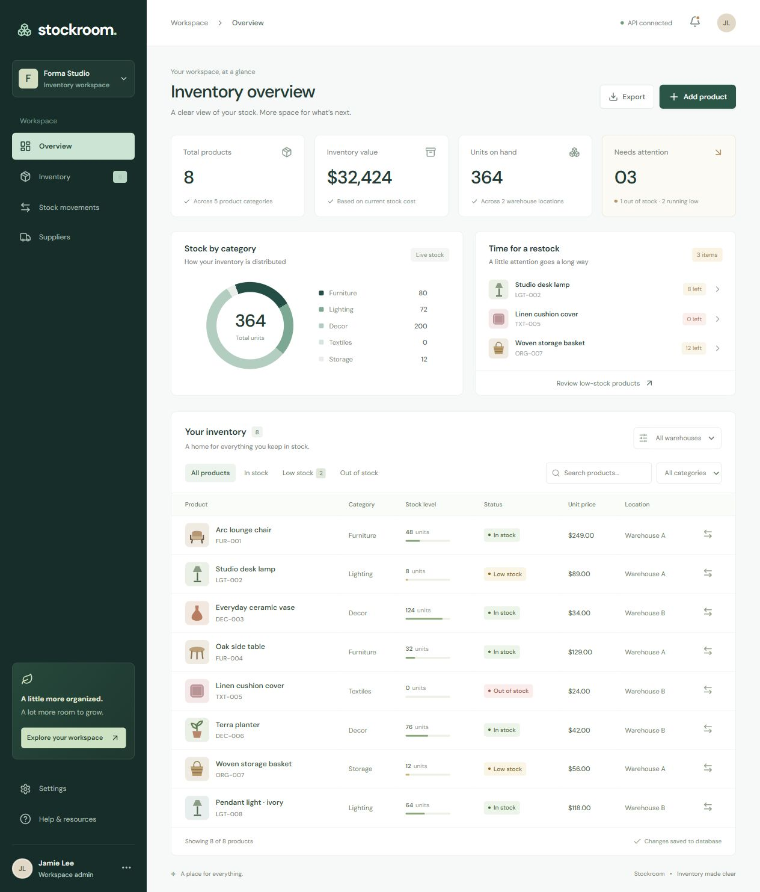

# Stockroom

A React 19 + Laravel 13 inventory starter for a furniture and home goods workspace. The interface includes a dashboard, product catalog, low-stock alerts, warehouse and category filters, stock movement history, and CSV export.

## Start locally

Requirements: PHP 8.3+, Composer, Node.js 20.19+ or 22.12+, and PHP SQLite support. The project was verified with PHP 8.4 and Node 24.

```powershell
cd backend
composer install
Copy-Item .env.example .env # first setup only; keep an existing .env
php artisan key:generate
# Create the SQLite file if it does not already exist.
if (!(Test-Path database/database.sqlite)) { New-Item database/database.sqlite -ItemType File }
php artisan migrate --seed
cd ../frontend
npm ci
cd ..
```

In separate terminals from the project root:

```powershell
npm run dev:backend
npm run dev:frontend
```

Open http://127.0.0.1:5173. The React development server proxies `/api` to Laravel on port **8017**, configured in `frontend/vite.config.js`.



## Structure

- `frontend/src/App.jsx`: application state, navigation, filters, dialogs, and API integration.
- `frontend/src/components/`: metric cards and product illustrations.
- `frontend/src/data.js`: demo catalog and helpers.
- `frontend/src/styles.css`: responsive layout and visual system.
- `backend/app/Http/Controllers/`: product, stock movement, and dashboard APIs.
- `backend/app/Http/Requests/SaveProductRequest.php`: product validation.
- `backend/database/migrations/`: inventory schema.
- `backend/database/seeders/DatabaseSeeder.php`: idempotent demo catalog seed.
- `backend/tests/Feature/InventoryTest.php`: inventory and stock validation tests.

## Behavior

When Laravel is available, products and stock movements persist in SQLite. Without the API, the frontend uses clearly labeled demo mode and saves changes on the current device. Demo data is separate from database data and is not automatically imported.

Stock adjustments run in database transactions, reject negative resulting inventory, and create movement records. Editing a product's stock also records the delta. Product SKUs must be unique. Prices use decimal storage. CSV exports respect the current filters and protect against spreadsheet formula interpretation.

The supplier directory, workspace profile, and preferences are UI examples. Authentication, team permissions, supplier CRUD, pagination, and deployment configuration are extension points. The API is intended for local development; add authentication and authorization before hosting it.

## Checks

```powershell
npm run build
npm test
```

For a production frontend, serve `frontend/dist` and route `/api` to Laravel on the same origin. Configure the Laravel environment and database for your deployment.
